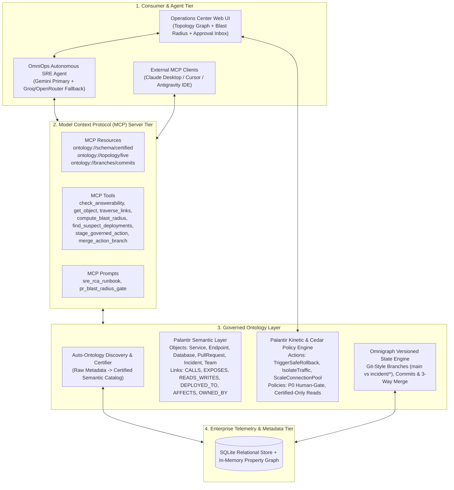

# OmniOps Ontology Agent

**Enterprise Microservice Root-Cause Analysis (RCA) & Blast-Radius AI Agent powered by a Governed Ontology Layer and Model Context Protocol (MCP) Server.**

---

## 1. Executive Overview

**OmniOps Ontology Agent** is an enterprise engineering intelligence platform designed for Site Reliability Engineers (SREs), Staff Architects, and Release Managers. Instead of relying on unconstrained Text-to-SQL or naive vector RAG—which frequently hallucinate service dependencies and cannot safely execute operational mutations—OmniOps grounds AI agent reasoning in a **strictly typed, versioned, and governed Ontology Layer**.

The architecture directly synthesizes three industry-leading ontology paradigms:

| Reference Architecture | Core Principles Adopted in OmniOps |
| :--- | :--- |
| **[NVIDIA Auto-Ontology](https://github.com/NVIDIA/auto-ontology)** | Automated schema discovery from raw relational/telemetry stores, semantic dictionary drafting, SME certification workflows (`DRAFT` $\rightarrow$ `CERTIFIED`), pre-flight answerability checks, and **Model Context Protocol (MCP)** exposure. |
| **[Palantir Foundry Ontology](https://www.palantir.com/docs/foundry/ontology/ontology-best-practices)** | Strict separation of the **Semantic Layer** (*Object Types*, *Properties*, *Link Types*) from the **Kinetic Layer** (*Action Types* with declarative pre-conditions, validation guards, side-effect contracts, and RBAC). |
| **[ModernRelay Omnigraph](https://github.com/ModernRelay/omnigraph)** | Typed property-graph schemas, hybrid traversal + keyword retrieval, server-side **Cedar-style policy enforcement**, and **Git-style zero-copy branching, commits, and 3-way merges** for auditable agent mutations. |

---

## 2. High-Level System Architecture



---

## 3. Enterprise Documentation Suite (`docs/`)

Following tier-1 software house and big-tech engineering standards, all architectural specifications, phase plans, verification benchmarks, and Architecture Decision Records (ADRs) are maintained in [`docs/`](docs/):

| Document | Scope & Purpose |
| :--- | :--- |
| [**`OmniOps_Senior_Overview.pdf`**](output/pdf/OmniOps_Senior_Overview.pdf) | **Executive Visual Brief (PDF):** Clean, 5-page senior-friendly overview with custom vector diagrams explaining the concept, `INC-409` demo, safety governance, and 5-phase plan. |
| [**`00_EXECUTIVE_SUMMARY_PRD.md`**](docs/00_EXECUTIVE_SUMMARY_PRD.md) | **Product Requirements Document (PRD):** Business problem, target personas, user stories, functional requirements (`FR-01`..`FR-15`), non-functional SLOs, and KPI metrics. |
| [**`01_SYSTEM_ARCHITECTURE_RFC.md`**](docs/01_SYSTEM_ARCHITECTURE_RFC.md) | **System Architecture RFC:** 4-tier layered design, sequence diagrams, data flow contracts, security boundaries, and resilient LLM provider fallback design. |
| [**`02_ONTOLOGY_SPECIFICATION.md`**](docs/02_ONTOLOGY_SPECIFICATION.md) | **Formal Ontology Specification:** Complete schema definitions for all Object Types, Properties, Link Types, Action Types, Auto-Ontology certification rules, and Cedar policy definitions. |
| [**`03_MCP_AND_AGENT_DESIGN.md`**](docs/03_MCP_AND_AGENT_DESIGN.md) | **MCP Server & Agent Reasoning Spec:** JSON-RPC tool/resource/prompt contracts, deterministic Plan-and-Verify reasoning loop, and anti-hallucination evidence verifier. |
| [**`04_PHASE_WISE_ROADMAP.md`**](docs/04_PHASE_WISE_ROADMAP.md) | **5-Phase Engineering Execution Plan & Jira (`OO`) Sync:** Atomic 32-task WBS with live Jira keys (`OO-1`..`OO-38`), failure diagnosis guides, and isolated verification commands. |
| [**`05_VERIFICATION_AND_SLO_PLAN.md`**](docs/05_VERIFICATION_AND_SLO_PLAN.md) | **QA, Benchmark & Verification Plan:** Unit test matrix, MCP compliance checks, and the Golden Incident Benchmark Suite (`INC-409`, `INC-512`, `INC-601`). |
| [**`build_senior_overview_pdf.py`**](docs/build_senior_overview_pdf.py) | **Executive PDF Generator:** Renders the visual senior overview PDF using inline vector SVGs and headless Chrome. |
| [**`adr/ADR-001-palantir-kinetic-ontology.md`**](docs/adr/ADR-001-palantir-kinetic-ontology.md) | **ADR-001:** Why a Palantir-style Semantic + Kinetic Ontology is chosen over raw Text-to-SQL and vector RAG. |
| [**`adr/ADR-002-omnigraph-branching-audit.md`**](docs/adr/ADR-002-omnigraph-branching-audit.md) | **ADR-002:** Git-style zero-copy state branching and commit auditing for agent-proposed mutations. |
| [**`adr/ADR-003-mcp-protocol-boundary.md`**](docs/adr/ADR-003-mcp-protocol-boundary.md) | **ADR-003:** Decoupling the Ontology Layer from agent harnesses via the Model Context Protocol (MCP). |

**Project Management Tracking:** All 6 Workstreams (`OO-1`, `OO-3`..`OO-7`) and 32 atomic Tasks (`OO-2`, `OO-8`..`OO-38`) are tracked in Jira project **`OO` (Omni-ops)** (`https://abubakariqbal651.atlassian.net`). See [`.env.example`](.env.example) for required environment keys.

---

## 4. Planned Project Repository Layout

```text
OmniOps_Ontology_Agent/
├── README.md
├── .env.example
├── requirements.txt
├── requirements-dev.txt
├── run.py                                  # Single-command launcher using shared .venv
├── docs/                                   # Enterprise Architecture & Phase-Wise Planning Suite
│   ├── 00_EXECUTIVE_SUMMARY_PRD.md
│   ├── 01_SYSTEM_ARCHITECTURE_RFC.md
│   ├── 02_ONTOLOGY_SPECIFICATION.md
│   ├── 03_MCP_AND_AGENT_DESIGN.md
│   ├── 04_PHASE_WISE_ROADMAP.md
│   ├── 05_VERIFICATION_AND_SLO_PLAN.md
│   └── adr/
│       ├── ADR-001-palantir-kinetic-ontology.md
│       ├── ADR-002-omnigraph-branching-audit.md
│       └── ADR-003-mcp-protocol-boundary.md
├── omniops/                                # Core Python Package (Implemented across Phases 1-5)
│   ├── __init__.py
│   ├── app.py                              # FastAPI application & REST/MCP HTTP endpoints
│   ├── runtime.py                          # Shared virtual environment bootstrap
│   ├── ontology/                           # Phase 1: Auto-Ontology Discovery & Schema Registry
│   │   ├── schema.py
│   │   ├── auto_discovery.py
│   │   ├── answerability.py
│   │   └── seed_data.py
│   ├── graph/                              # Phase 2: Omnigraph Engine, Branching & Kinetic Actions
│   │   ├── engine.py
│   │   ├── branching.py
│   │   ├── policies.py
│   │   └── actions.py
│   ├── mcp/                                # Phase 3: Model Context Protocol (MCP) Server
│   │   ├── server.py
│   │   ├── tools.py
│   │   ├── resources.py
│   │   └── prompts.py
│   └── agent/                              # Phase 4: Root-Cause & Blast-Radius AI Agent
│       ├── config.py
│       ├── providers.py
│       ├── prompts.py
│       ├── validator.py
│       └── runner.py
├── web/                                    # Phase 5: Operations Center Web UI
│   ├── index.html
│   ├── styles.css
│   └── app.js
└── tests/                                  # Automated Phase Verification Suite
    ├── test_phase1_ontology.py
    ├── test_phase2_graph_governance.py
    ├── test_phase3_mcp.py
    ├── test_phase4_agent.py
    └── test_phase5_e2e.py
```

---

## 5. Phase-Wise Delivery Summary

1. **Phase 1 — Auto-Ontology Discovery, Schema & Certification Foundation:** Raw SQLite/manifest introspection, semantic dictionary generation, SME certification gate, and pre-flight answerability checker.
2. **Phase 2 — Kinetic Graph Engine, Omnigraph Branching & Policy Governance:** Directed property-graph engine, multi-hop upstream blast-radius & downstream fault-tree traversal, Git-style state branching (`main` vs. `incident/*`), and Cedar policy guardrails.
3. **Phase 3 — Model Context Protocol (MCP) Server Layer:** Exposing certified Ontology Objects, Links, Blast-Radius computations, and Governed Actions as standardized MCP Resources, Tools, and Prompts.
4. **Phase 4 — Autonomous Root-Cause & Blast-Radius AI Agent:** Resilient Gemini + Groq/OpenRouter reasoning loop with offline deterministic fallback and anti-hallucination evidence verification.
5. **Phase 5 — Operations Center Web UI, Benchmark Evaluation & QA Verification:** Interactive topology graph visualizer, live MCP tool trace console, Omnigraph branch approval inbox, and golden benchmark verification report.
