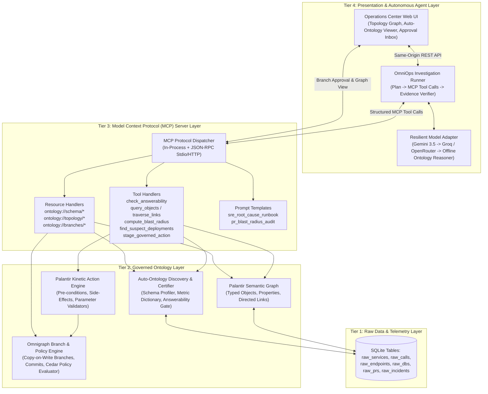
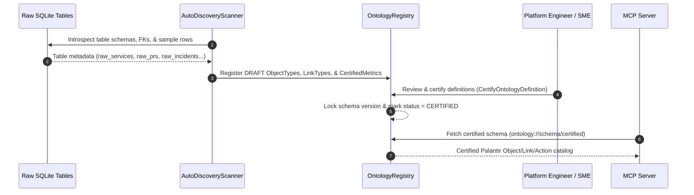

# 01 — System Architecture RFC

| Metadata | Details |
| :--- | :--- |
| **Document ID** | `OMNIOPS-RFC-001` |
| **Title** | Four-Tier Ontology-Grounded Agent & MCP Architecture |
| **Status** | Approved Specification |
| **Related Docs** | [`00_EXECUTIVE_SUMMARY_PRD.md`](00_EXECUTIVE_SUMMARY_PRD.md), [`02_ONTOLOGY_SPECIFICATION.md`](02_ONTOLOGY_SPECIFICATION.md), [`03_MCP_AND_AGENT_DESIGN.md`](03_MCP_AND_AGENT_DESIGN.md) |

---

## 1. Architectural Philosophy

Enterprise AI systems fail when the LLM is forced to infer domain semantics at query time from raw tables or unstructured text. **OmniOps** enforces a strict **Four-Tier Separation of Concerns**:

1. **Tier 1 — Raw Persistence & Telemetry Store (SQLite + JSON Manifests):** Represents the messy reality of enterprise tables, service registries, deployment logs, and alert streams.
2. **Tier 2 — Governed Ontology Engine (Auto-Ontology + Palantir + Omnigraph):** Transforms raw records into certified **Objects** and **Links**, tracks state changes across Git-like **Branches**, and gates all mutations behind **Kinetic Actions** and **Cedar Policies**.
3. **Tier 3 — Model Context Protocol (MCP) Server Boundary:** Exposes the Ontology Engine via standardized MCP `Resources`, `Tools`, and `Prompts` so any agent interacts with a uniform, self-describing contract.
4. **Tier 4 — Autonomous SRE Agent & Operations Center UI:** Executes multi-step root-cause and blast-radius investigations, verifies every cited fact against MCP tool traces, and surfaces proposed remediation branches into an interactive **Approval Inbox**.

---

## 2. Layered Component Diagram



---

## 3. Core Execution Flows (Sequence Diagrams)

### 3.1 Auto-Ontology Discovery & Certification Flow (Phase 1)

Inspired by **NVIDIA Auto-Ontology**, raw relational tables are never queried directly by the agent. Instead, the Auto-Ontology scanner profiles the tables, drafts semantic mappings, and requires certification before exposing them to the MCP server.



### 3.2 Incident Root-Cause, Blast Radius & Branch-Staged Remediation Flow (Phases 2–5)

When an incident occurs (`INC-409`), the agent uses MCP tools to inspect the ontology, traverse upstream blast radius and downstream dependencies, pinpoint the culprit PR, and stage a rollback on an isolated **Omnigraph branch**.

```mermaid
sequenceDiagram
    autonumber
    participant SRE as On-Call SRE (Web UI)
    participant Agent as OmniOps SRE Agent
    participant MCP as MCP Server
    participant Graph as SemanticGraph & BlastRadius
    participant Omni as Omnigraph Branch & Policy Engine

    SRE->>Agent: "Investigate INC-409, calculate blast radius, and propose fix"
    Agent->>MCP: call_tool("check_question_answerability", question)
    MCP-->>Agent: {answerable: true, mapped_objects: ["Incident", "Service", "PullRequest"]}

    Agent->>MCP: call_tool("get_ontology_object", {type: "Incident", id: "INC-409"})
    MCP->>Graph: Lookup INC-409 & AFFECTS links
    Graph-->>MCP: Incident INC-409 -> affects SVC-PAYMENT-GW
    MCP-->>Agent: Structured Incident + root service SVC-PAYMENT-GW

    Agent->>MCP: call_tool("compute_blast_radius", {service_id: "SVC-PAYMENT-GW", max_depth: 3})
    MCP->>Graph: Reverse BFS along CALLS links
    Graph-->>MCP: Impacted P0: [SVC-CHECKOUT, SVC-MOBILE-GW], P1: [SVC-SUBSCRIPTION]
    MCP-->>Agent: Deterministic BlastRadiusReport

    Agent->>MCP: call_tool("find_suspect_deployments", {incident_id: "INC-409", window_minutes: 120})
    MCP->>Graph: Correlate DEPLOYED_TO & READS_WRITES within time window
    Graph-->>MCP: Ranked Suspect #1: PR-882 (merged 22m before incident on SVC-PAYMENT-GW)
    MCP-->>Agent: SuspectPR list with confidence scores & file evidence

    Agent->>MCP: call_tool("stage_governed_action", {action: "TriggerSafeRollback", target: "SVC-PAYMENT-GW", to_version: "v2.4.1"})
    MCP->>Omni: Evaluate Cedar Policy (Actor=Agent, TargetTier=P0, Branch=incident/INC-409-fix)
    Omni-->>Omni: Policy PERMITS staging on branch; FORBIDS direct merge to main
    Omni-->>MCP: Branch "incident/INC-409-fix" created with Commit #c8f92a
    MCP-->>Agent: StagedActionProposal (awaiting human merge approval)

    Agent-->>SRE: Verified RCA Report + Blast Radius Graph + Pending Approval Card
    SRE->>Omni: Click "Approve & Merge Branch incident/INC-409-fix -> main"
    Omni-->>SRE: 3-Way Merge Committed (#m41e0b) -> SVC-PAYMENT-GW rolled back to v2.4.1
```

---

## 4. Key Architectural Mechanisms

### 4.1 Pre-Flight Answerability & Anti-Hallucination Gate
Before generating a diagnosis, OmniOps applies two deterministic barriers:
1. **Input Barrier (`check_question_answerability`):** Parses requested domain concepts and verifies that corresponding certified `ObjectType`, `PropertyDef`, or `LinkType` definitions exist. If a user asks about unmodeled concepts (e.g., *"What was the office Wi-Fi packet loss?"*), the agent immediately reports which concepts are outside the certified ontology rather than guessing.
2. **Output Barrier (`EvidenceValidator`):** Before committing an `InvestigationReport`, Python extracts every identifier (`SVC-*`, `PR-*`, `INC-*`, `DB-*`, `EP-*`) and version string referenced in the LLM's response and asserts that each identifier appeared in the session's MCP tool call outputs. If an unverified entity is detected, the validator triggers a corrective retry (matching the proven pattern in `Voice_Coach/server/providers.py`).

### 4.2 Omnigraph Copy-on-Write Branching & 3-Way Merge
Inspired by **ModernRelay Omnigraph**:
- The production ontology graph lives on branch `main` at head commit $C_0$.
- When an agent proposes an operational mutation (such as rolling back `SVC-PAYMENT-GW` from `v2.5.0` to `v2.4.1` and resolving `INC-409`), the engine creates a zero-copy branch `incident/INC-409-rollback` forked from $C_0$.
- Queries on `incident/INC-409-rollback` reflect the simulated post-rollback state (allowing engineers to preview the health impact before execution!), while queries on `main` remain untouched.
- When an authorized human clicks **Approve & Merge**, the engine checks for conflicting concurrent edits on `main` (3-way merge check across base $C_0$, branch head, and current `main`), applies the state diff, and records an immutable audit commit.

### 4.3 Resilient Multi-Tier Reasoning Engine
To ensure zero downtime across development, testing, and live demonstrations, `omniops/agent/providers.py` implements a 3-tier fallback chain:
1. **Primary LLM:** Google Gemini (`GEMINI_API_KEY`) with structured JSON schema output.
2. **Secondary LLM Fallback:** Groq (`GROQ_API_KEY`, `openai/gpt-oss-20b`) or OpenRouter (`OPENROUTER_API_KEY`) using strict JSON schema mode.
3. **Tertiary Deterministic Ontology Reasoner:** If no external API keys are configured (or network is offline), a deterministic Python graph-walk planner executes the exact same MCP tool chain (`get_ontology_object` $\rightarrow$ `compute_blast_radius` $\rightarrow$ `find_suspect_deployments` $\rightarrow$ `stage_governed_action`) and synthesizes a schema-compliant `InvestigationReport`.

---

## 5. Security & Operational Guardrails

- **Credential Isolation:** API keys are read exclusively from untracked `.env` files on the server and never transmitted to the browser or exposed in MCP error payloads.
- **Key Redaction:** Any provider diagnostic message automatically scrubs patterns matching `AIza*`, `gsk_*`, and `sk-or-v1-*`.
- **Policy Enforcement on Actions:** Even if a prompt injection attempts to force an immediate destructive action on `main`, `CedarPolicyEvaluator` operates in deterministic Python inside the Ontology Engine and rejects direct `main` mutations by non-human principals.
