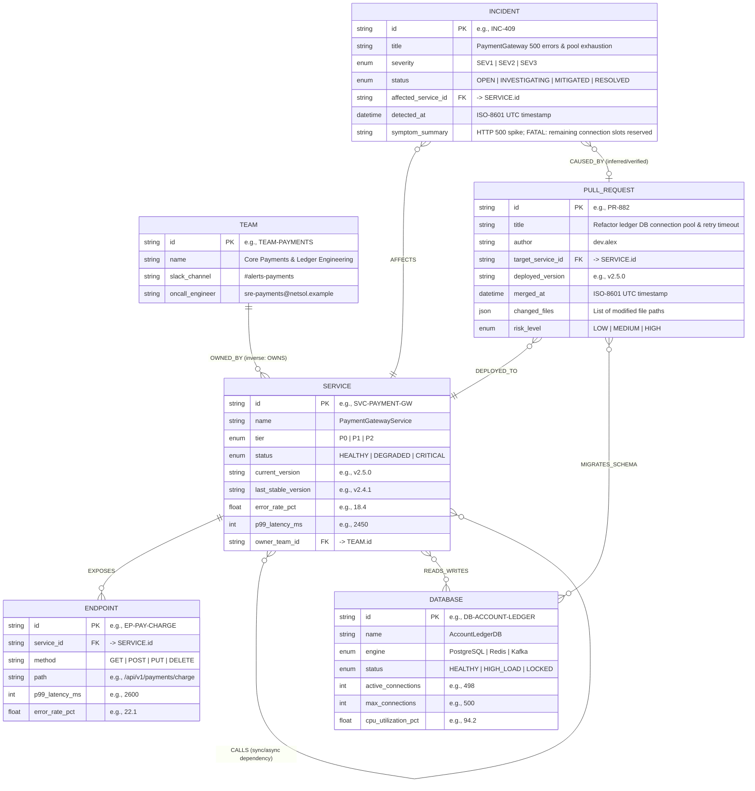

# 02 — Formal Ontology Specification (Palantir + Auto-Ontology + Omnigraph)

| Metadata | Details |
| :--- | :--- |
| **Document ID** | `OMNIOPS-ONT-002` |
| **Title** | Domain Ontology Schema: Semantic Objects, Links, Kinetic Actions & Cedar Policies |
| **Status** | Approved v1.0 Schema |
| **Related Docs** | [`01_SYSTEM_ARCHITECTURE_RFC.md`](01_SYSTEM_ARCHITECTURE_RFC.md), [`03_MCP_AND_AGENT_DESIGN.md`](03_MCP_AND_AGENT_DESIGN.md) |

---

## 1. Ontology Design Principles

Following **Palantir Foundry Ontology Best Practices**, our ontology is organized into three distinct layers:

1. **The Semantic Layer (Nouns & Relationships):** Defines *what exists* in the enterprise (`Object Types`, `Properties`) and *how things connect* (`Link Types`), mapped cleanly from underlying physical tables via **NVIDIA Auto-Ontology** discovery manifests.
2. **The Kinetic Layer (Verbs & Operations):** Defines *how the state of the world can change* (`Action Types`), encapsulating business logic, parameter validation, pre-conditions, and side effects.
3. **The Governance & Versioning Layer (Omnigraph Rules):** Defines *who can perform which actions under what conditions* (`Cedar Policies`) and tracks all mutations as immutable commits on **Omnigraph branches**.

---

## 2. Entity-Relationship & Link Topology Diagram



---

## 3. Semantic Layer: Object Types Catalog

Each `ObjectType` is backed by a physical SQLite table and mapped through the Auto-Ontology Semantic Dictionary.

### 3.1 `Service` (`ObjectType`)
- **Primary Key:** `id` (`str`, pattern `^SVC-[A-Z0-9-]+$`)
- **Title Property:** `name`
- **Source Table Mapping:** `raw_services`
- **Certification Status:** `CERTIFIED`
- **Properties:**
  - `tier`: Criticality tier (`P0` = Revenue/Customer-blocking, `P1` = Core internal workflow, `P2` = Background/Non-critical).
  - `status`: Operational health (`HEALTHY`, `DEGRADED`, `CRITICAL`).
  - `current_version`: Active container/release tag in production.
  - `last_stable_version`: Known-good previous release tag eligible for rollback.
  - `error_rate_pct`: Current 5-minute rolling HTTP 5xx error percentage.
  - `p99_latency_ms`: Current 5-minute 99th percentile latency in milliseconds.

### 3.2 `Endpoint` (`ObjectType`)
- **Primary Key:** `id` (`str`, pattern `^EP-[A-Z0-9-]+$`)
- **Source Table Mapping:** `raw_endpoints`
- **Certification Status:** `CERTIFIED`
- **Properties:** `service_id`, `method`, `path`, `p99_latency_ms`, `error_rate_pct`, `sla_latency_ms`.

### 3.3 `Database` (`ObjectType`)
- **Primary Key:** `id` (`str`, pattern `^DB-[A-Z0-9-]+$`)
- **Source Table Mapping:** `raw_databases`
- **Certification Status:** `CERTIFIED`
- **Properties:** `name`, `engine` (`PostgreSQL`, `Redis`, `Kafka`), `status`, `active_connections`, `max_connections`, `cpu_utilization_pct`, `schema_version`.

### 3.4 `PullRequest` (`ObjectType`)
- **Primary Key:** `id` (`str`, pattern `^PR-[0-9]+$`)
- **Source Table Mapping:** `raw_pull_requests`
- **Certification Status:** `CERTIFIED`
- **Properties:** `title`, `author`, `target_service_id`, `deployed_version`, `merged_at`, `changed_files` (`list[str]`), `touches_db_config` (`bool`), `touches_schema` (`bool`), `risk_level`.

### 3.5 `Incident` (`ObjectType`)
- **Primary Key:** `id` (`str`, pattern `^INC-[0-9]+$`)
- **Source Table Mapping:** `raw_incidents`
- **Certification Status:** `CERTIFIED`
- **Properties:** `title`, `severity` (`SEV1`, `SEV2`, `SEV3`), `status`, `affected_service_id`, `detected_at`, `symptom_summary`, `root_cause_pr_id` (`Optional[str]`).

### 3.6 `Team` (`ObjectType`)
- **Primary Key:** `id` (`str`, pattern `^TEAM-[A-Z0-9-]+$`)
- **Source Table Mapping:** `raw_teams`
- **Certification Status:** `CERTIFIED`
- **Properties:** `name`, `slack_channel`, `oncall_engineer`, `escalation_policy`.

---

## 4. Semantic Layer: Link Types Catalog

| Link Type ID | Source Object $\rightarrow$ Target Object | Cardinality | Edge Attributes | Operational Semantics |
| :--- | :--- | :--- | :--- | :--- |
| **`CALLS`** | `Service` $\rightarrow$ `Service` | `M:N` | `call_type` (`SYNC_HTTP`, `GRPC`, `ASYNC_EVENT`), `rpm` (requests/min), `hard_dependency` (`bool`) | If `B` fails and `A --CALLS(hard=True)--> B`, then `A` is in `B`'s **upstream blast radius**. |
| **`EXPOSES`** | `Service` $\rightarrow$ `Endpoint` | `1:N` | — | Maps API routes to their owning microservice. |
| **`READS_WRITES`** | `Service` $\rightarrow$ `Database` | `M:N` | `access_mode` (`READ_ONLY`, `READ_WRITE`), `pool_size` (`int`) | Connects services to stateful persistence engines in the downstream fault tree. |
| **`DEPLOYED_TO`** | `PullRequest` $\rightarrow$ `Service` | `N:1` | `deployment_id`, `deployed_at` | Tracks code/config changes shipped to a microservice. |
| **`MIGRATES_SCHEMA`** | `PullRequest` $\rightarrow$ `Database` | `M:N` | `migration_script`, `backward_compatible` (`bool`) | Tracks DDL/schema changes applied to a database. |
| **`AFFECTS`** | `Incident` $\rightarrow$ `Service` | `N:1` | `impact_type` (`OUTAGE`, `LATENCY`, `ERROR_SPIKE`) | Links an active alert/incident to its primary failing service. |
| **`OWNED_BY`** | `Service` $\rightarrow$ `Team` | `N:1` | — | Identifies the engineering squad responsible for triage and approvals. |

---

## 5. Auto-Ontology Certified Metrics & Semantic Formulas

Inspired by **NVIDIA Auto-Ontology**, common analytical calculations are pre-certified in the ontology so the LLM never invents ad-hoc math formulas:

1. **`connection_saturation_ratio` (`Database`)**:
   $$\text{Saturation Ratio} = \frac{\text{active\_connections}}{\text{max\_connections}}$$
   *Certified Threshold:* `>= 0.90` classifies the database as `CONNECTION_EXHAUSTED`.
2. **`blast_radius_severity_score` (`Service`)**:
   $$\text{Score} = 10 \times N_{\text{upstream P0}} + 4 \times N_{\text{upstream P1}} + 1 \times N_{\text{upstream P2}}$$
3. **`deployment_suspect_score` (`PullRequest`, `Incident`)**:
   Deterministic heuristic ranking PRs deployed within `[detected_at - 120m, detected_at]` along the affected service or its downstream dependencies, weighted by temporal proximity, `touches_db_config`, and `touches_schema`.

---

## 6. Kinetic Layer: Governed Action Types

Following Palantir Foundry best practices, **Actions** are the *only* permitted mechanism for modifying ontology state.

### 6.1 `TriggerSafeRollback`
- **Description:** Reverts a `Service` from its faulty `current_version` to a verified `target_version` (typically `last_stable_version`) and updates associated active incidents to `MITIGATED`.
- **Parameters:** `service_id: str`, `target_version: str`, `incident_id: str`, `justification: str`
- **Pre-Conditions:**
  1. `Service(service_id)` exists and `status in ("CRITICAL", "DEGRADED")`.
  2. `target_version != Service.current_version`.
  3. An active `Incident(incident_id)` is linked to `service_id`.
- **State Mutation (Side Effects):**
  - Sets `Service.current_version = target_version`
  - Sets `Service.status = "HEALTHY"` and resets `error_rate_pct` to baseline (`0.2%`)
  - Sets `Incident.status = "MITIGATED"`

### 6.2 `ScaleDatabaseConnectionPool`
- **Description:** Adjusts a service's connection pool cap or a database's `max_connections` ceiling to relieve saturation.
- **Parameters:** `database_id: str`, `new_max_connections: int`, `incident_id: str`, `justification: str`
- **Pre-Conditions:** `100 <= new_max_connections <= 2000` and `Database(database_id)` exists.

### 6.3 `IsolateServiceTraffic`
- **Description:** Enables circuit-breaker fallback / degrades non-critical callers to protect a struggling downstream service.
- **Parameters:** `caller_service_id: str`, `target_service_id: str`, `fallback_mode: str`, `justification: str`

### 6.4 `CertifyOntologyDefinition`
- **Description:** Administrative action allowing a Platform Owner to promote a `DRAFT` Auto-Ontology object or metric definition to `CERTIFIED`.
- **Parameters:** `entity_kind: str`, `entity_name: str`, `reviewer: str`

---

## 7. Governance Layer: Cedar-Inspired Policy Rules & Omnigraph Branching

Every invocation of a Kinetic Action is evaluated against declarative policy rules before any state change occurs:

```text
// Policy 1: Agents may stage any valid kinetic action on an isolated incident/* branch
permit (
    principal in Role::"AutonomousAgent",
    action in [Action::"TriggerSafeRollback", Action::"ScaleDatabaseConnectionPool", Action::"IsolateServiceTraffic"],
    resource
) when {
    context.target_branch != "main" &&
    context.target_branch_prefix == "incident/"
};

// Policy 2: Agents are FORBIDDEN from directly mutating the "main" production branch
forbid (
    principal in Role::"AutonomousAgent",
    action,
    resource
) when {
    context.target_branch == "main"
};

// Policy 3: Merging an incident branch affecting a P0 or P1 service into "main" requires a Human Approver
permit (
    principal in Role::"HumanSRE",
    action == Action::"MergeBranchToMain",
    resource
) when {
    context.has_valid_justification == true
};
```
