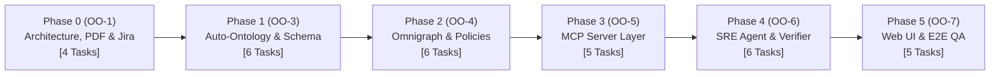

# 04 — 5-Phase Engineering Execution Roadmap & Atomic Diagnostic WBS

| Metadata | Details |
| :--- | :--- |
| **Document ID** | `OMNIOPS-PLAN-004` |
| **Title** | Phase-Wise Enterprise SDLC Plan with Atomic Task Diagnostics & Jira (`OO`) Sync |
| **Methodology** | Milestone-Driven Iterative Engineering with Isolated Per-Task Test Gates |
| **Jira Project** | **`OO` (Omni-ops)** — `https://abubakariqbal651.atlassian.net` |
| **Related Docs** | [`00_EXECUTIVE_SUMMARY_PRD.md`](00_EXECUTIVE_SUMMARY_PRD.md), [`05_VERIFICATION_AND_SLO_PLAN.md`](05_VERIFICATION_AND_SLO_PLAN.md) |

---

## 1. Why Every Phase Is Divided Into Atomic Diagnostic Tasks

In tier-1 software houses, work is decomposed into **single-responsibility atomic tasks** so that:
1. **1-to-1 Jira Alignment:** Every engineering unit has an exact Jira key (`OO-*`) nested under its Phase Workstream (`OO-1`, `OO-3`..`OO-7`).
2. **Instant Problem Isolation:** Every task maps to **1 primary module**, a clear **Input $\rightarrow$ Output contract**, a **Failure Diagnosis Guide**, and an **isolated unit test command**. If something breaks during integration, you immediately know *which exact task and file* is responsible.
3. **Strict Phase Gates:** A phase only moves to `Done` in Jira when its test gate task passes 100%.

---

## 2. Jira Workflow Alignment Policy (`OO` Board)

| Jira State | Meaning & Transition Rule |
| :--- | :--- |
| **`To Do`** (`21`) | Task specification and diagnostic contract are defined; ready for engineering start. |
| **`In Progress`** (`31`) | Active file implementation is underway for that specific Task ID (`P*-T*`). Parent Workstream moves to `In Progress` when its first child task starts. |
| **`Done`** (`41`) | Code/artifact is complete **AND** its exact isolated verification command passes cleanly. Parent Workstream moves to `Done` only after all child tasks (including the Phase Gate task) are `Done`. |

---

## 3. Master Workstream & Atomic Task Breakdown (6 Workstreams, 32 Tasks)

### Phase 0 — Enterprise Architecture, Planning Suite & Senior Brief (`OO-1`)

| Task ID | Jira Key | Task & File Ownership | Input $\rightarrow$ Output Contract | Failure Diagnosis Guide | Isolated Verification Command |
| :--- | :--- | :--- | :--- | :--- | :--- |
| `P0-T1` | `OO-2` | **PRD, Architecture RFC & Ontology Spec** `docs/00..02_*.md` | User & reference specs $\rightarrow$ Formal PRD, 4-tier RFC, and Object/Link/Action schema | Mismatched entity names, link cardinality, or Cedar policy rules trace here | `test -s docs/00_EXECUTIVE_SUMMARY_PRD.md && test -s docs/01_SYSTEM_ARCHITECTURE_RFC.md && test -s docs/02_ONTOLOGY_SPECIFICATION.md` |
| `P0-T2` | `OO-8` | **MCP Contract, Roadmap, QA Plan & ADRs** `docs/03..05_*.md`, `docs/adr/*` | Architecture RFC $\rightarrow$ JSON-RPC MCP schema, 32-task WBS, Golden Benchmarks, ADRs | Discrepancies in MCP tool payloads, WBS boundaries, or benchmark specs | `ls -la docs docs/adr` |
| `P0-T3` | `OO-9` | **Visual Senior Executive Overview PDF** `docs/build_senior_overview_pdf.py`, `output/pdf/OmniOps_Senior_Overview.pdf` | Enterprise specs $\rightarrow$ Crisp 5-page A4 executive PDF with inline vector SVGs | PDF page overflow, Chrome rendering error, or clipped SVG labels | `python3 docs/build_senior_overview_pdf.py && pdfinfo output/pdf/OmniOps_Senior_Overview.pdf` |
| `P0-T4` | `OO-10` | **Jira Board (`OO`) Alignment** `docs/04_PHASE_WISE_ROADMAP.md`, Jira `OO` | 32-task WBS $\rightarrow$ Synced Workstreams (`OO-1,3..7`) & Tasks (`OO-2,8..38`) | Missing Jira keys, broken parent links, or stale Jira statuses | `JQL: project = OO ORDER BY key ASC` |

---

### Phase 1 — Auto-Ontology Discovery, Schema & Certification (`OO-3`)

| Task ID | Jira Key | Task & File Ownership | Input $\rightarrow$ Output Contract | Failure Diagnosis Guide | Isolated Verification Command |
| :--- | :--- | :--- | :--- | :--- | :--- |
| `P1-T1` | `OO-11` | **Core Ontology Pydantic Models** `omniops/ontology/__init__.py`, `schema.py` | Raw dict/JSON payloads $\rightarrow$ Validated `ObjectType`, `LinkType`, `ActionType`, `CertifiedMetric`, `AnswerabilityReport` | `ValidationError` on `Service`/`PR`/`Incident` fields or broken ID regex (`^SVC-`, `^PR-`) | `/home/bakar/Documents/NAVTTC/.venv/bin/python -m unittest tests.test_phase1_ontology.TestOntologySchema -v` |
| `P1-T2` | `OO-12` | **SQLite Telemetry & Golden Seed DB** `omniops/ontology/seed_data.py` | Seed spec $\rightarrow$ SQLite DB with 6 services, 6 endpoints, 3 DBs, 3 teams, 6 PRs, 3 incidents (`INC-409/512/601`), 1 draft table (`raw_wifi_telemetry`) | Missing golden incident records, invalid FK links, or non-deterministic timestamps | `/home/bakar/Documents/NAVTTC/.venv/bin/python -m unittest tests.test_phase1_ontology.TestSeedDatabase -v` |
| `P1-T3` | `OO-13` | **Auto-Ontology Schema & FK Scanner** `omniops/ontology/auto_discovery.py` | SQLite connection $\rightarrow$ Auto-discovered semantic catalog (`DRAFT` + `CERTIFIED` definitions + join paths) | Missing discovered columns, missed SQLite FKs, or `raw_wifi_telemetry` wrongly marked certified | `/home/bakar/Documents/NAVTTC/.venv/bin/python -m unittest tests.test_phase1_ontology.TestAutoDiscovery -v` |
| `P1-T4` | `OO-14` | **SME Certification Gate & Registry** `omniops/ontology/registry.py` | Discovery catalog $\rightarrow$ Guarded registry blocking `DRAFT` entities until `CertifyOntologyDefinition` | Queries returning uncertified `DRAFT` schemas or failing promotion to `CERTIFIED` | `/home/bakar/Documents/NAVTTC/.venv/bin/python -m unittest tests.test_phase1_ontology.TestCertificationGate -v` |
| `P1-T5` | `OO-15` | **Pre-Flight Question Answerability Checker** `omniops/ontology/answerability.py` | Natural-language question + registry $\rightarrow$ `AnswerabilityReport(answerable=bool, guidance=str)` | Out-of-domain queries passing through or valid SRE questions falsely rejected | `/home/bakar/Documents/NAVTTC/.venv/bin/python -m unittest tests.test_phase1_ontology.TestAnswerabilityChecker -v` |
| `P1-T6` | `OO-16` | **Phase 1 Unit & Diagnostic Test Gate** `tests/test_phase1_ontology.py` | Phase 1 modules $\rightarrow$ Consolidated Phase 1 pass/fail report | Isolate exact failing test class (`TestOntologySchema`..`TestAnswerabilityChecker`) | `/home/bakar/Documents/NAVTTC/.venv/bin/python -m unittest tests/test_phase1_ontology.py -v` |

---

### Phase 2 — Kinetic Graph Engine, Omnigraph Branching & Governance (`OO-4`)

| Task ID | Jira Key | Task & File Ownership | Input $\rightarrow$ Output Contract | Failure Diagnosis Guide | Isolated Verification Command |
| :--- | :--- | :--- | :--- | :--- | :--- |
| `P2-T1` | `OO-17` | **Directed Property Graph & Hybrid Search** `omniops/graph/__init__.py`, `engine.py` | Seeded registry $\rightarrow$ In-memory directed adjacency graph + `get_object()` + `search_objects()` | Missing graph edges, stale properties, or hybrid filter+keyword search misses | `/home/bakar/Documents/NAVTTC/.venv/bin/python -m unittest tests.test_phase2_graph_governance.TestGraphEngine -v` |
| `P2-T2` | `OO-18` | **Upstream Blast-Radius & Cycle-Safe BFS** `omniops/graph/blast_radius.py` | `service_id`, `max_depth` $\rightarrow$ `BlastRadiusReport` (hop-ordered callers, downstream DBs, `severity_score`) | Wrong hop distances, missed `P0` callers, infinite recursion on cycles, or math errors | `/home/bakar/Documents/NAVTTC/.venv/bin/python -m unittest tests.test_phase2_graph_governance.TestBlastRadius -v` |
| `P2-T3` | `OO-19` | **Causal PR Deployment Correlation** `omniops/graph/correlation.py` | `incident_id`, `lookback_minutes` $\rightarrow$ Ranked `SuspectDeployment` list with confidence scores | Incorrect #1 culprit PR (`PR-882` for `INC-409`, `PR-879` for `INC-512`, `PR-885` for `INC-601`) | `/home/bakar/Documents/NAVTTC/.venv/bin/python -m unittest tests.test_phase2_graph_governance.TestDeploymentCorrelation -v` |
| `P2-T4` | `OO-20` | **Omnigraph Copy-on-Write Branching & 3-Way Merge** `omniops/graph/branching.py` | Base branch + mutation $\rightarrow$ Isolated `incident/*` branch, SHA commit log, 3-way diff, conflict-checked merge | State leaking into `main` before approval, incorrect diffs, or missed concurrent merge conflicts | `/home/bakar/Documents/NAVTTC/.venv/bin/python -m unittest tests.test_phase2_graph_governance.TestOmnigraphBranching -v` |
| `P2-T5` | `OO-21` | **Cedar Policy Evaluator & Kinetic Actions** `omniops/graph/policies.py`, `actions.py` | `(actor_role, action, target_tier, branch)` $\rightarrow$ `PERMIT`/`FORBID` + executed state mutation on branch | Agent permitted to mutate `main` directly, skipped pre-conditions, or wrong post-rollback metrics | `/home/bakar/Documents/NAVTTC/.venv/bin/python -m unittest tests.test_phase2_graph_governance.TestPoliciesAndActions -v` |
| `P2-T6` | `OO-22` | **Phase 2 Graph & Governance Test Gate** `tests/test_phase2_graph_governance.py` | Phase 2 modules $\rightarrow$ Consolidated Phase 2 pass/fail report | Isolate exact failing test class (`TestBlastRadius`, `TestOmnigraphBranching`, etc.) | `/home/bakar/Documents/NAVTTC/.venv/bin/python -m unittest tests/test_phase2_graph_governance.py -v` |

---

### Phase 3 — Model Context Protocol (MCP) Server Layer (`OO-5`)

| Task ID | Jira Key | Task & File Ownership | Input $\rightarrow$ Output Contract | Failure Diagnosis Guide | Isolated Verification Command |
| :--- | :--- | :--- | :--- | :--- | :--- |
| `P3-T1` | `OO-23` | **MCP Ontology Resource Providers** `omniops/mcp/__init__.py`, `resources.py` | `ontology://*` URI $\rightarrow$ JSON payload for certified schema, drafts, topology, branches, diffs, commits | `404`/unknown resource URI or stale snapshot returned from branch resource | `/home/bakar/Documents/NAVTTC/.venv/bin/python -m unittest tests.test_phase3_mcp.TestMCPResources -v` |
| `P3-T2` | `OO-24` | **MCP Ontology Tools & JSON Schema Validators** `omniops/mcp/tools.py` | Tool name + JSON arguments $\rightarrow$ Validated tool result + latency telemetry event | Invalid parameter rejection errors, missing telemetry log entries, or wrong return shape | `/home/bakar/Documents/NAVTTC/.venv/bin/python -m unittest tests.test_phase3_mcp.TestMCPTools -v` |
| `P3-T3` | `OO-25` | **MCP SRE Runbook & PR Risk Prompts** `omniops/mcp/prompts.py` | Prompt name + args (`incident_id`/`pr_id`) $\rightarrow$ Structured MCP prompt message list | Missing required prompt arguments or malformed role/content blocks | `/home/bakar/Documents/NAVTTC/.venv/bin/python -m unittest tests.test_phase3_mcp.TestMCPPrompts -v` |
| `P3-T4` | `OO-26` | **JSON-RPC 2.0 MCP Dispatcher (In-Process, Stdio, HTTP)** `omniops/mcp/server.py` | JSON-RPC 2.0 request $\rightarrow$ Compliant `initialize`, `resources/*`, `tools/*`, `prompts/*` response | JSON-RPC error codes (`-32601`/`-32602`), stdio newline framing failures, or client handshake bugs | `/home/bakar/Documents/NAVTTC/.venv/bin/python -m unittest tests.test_phase3_mcp.TestMCPServerJSONRPC -v` |
| `P3-T5` | `OO-27` | **Phase 3 MCP Protocol Compliance Test Gate** `tests/test_phase3_mcp.py` | Phase 3 modules $\rightarrow$ Consolidated MCP compliance pass/fail report | Isolate exact failing test class (`TestMCPResources`..`TestMCPServerJSONRPC`) | `/home/bakar/Documents/NAVTTC/.venv/bin/python -m unittest tests/test_phase3_mcp.py -v` |

---

### Phase 4 — Autonomous Root-Cause Agent & Evidence Verifier (`OO-6`)

| Task ID | Jira Key | Task & File Ownership | Input $\rightarrow$ Output Contract | Failure Diagnosis Guide | Isolated Verification Command |
| :--- | :--- | :--- | :--- | :--- | :--- |
| `P4-T1` | `OO-28` | **Zero-Leak Env & Jira Config Loader** `omniops/agent/__init__.py`, `config.py`, `.env.example` | `.env` files + env vars $\rightarrow$ Immutable `Settings` dataclass without mutating `os.environ` | Missing API key fallback, invalid `PORT` validation, or leaked secrets in `repr()` | `/home/bakar/Documents/NAVTTC/.venv/bin/python -m unittest tests.test_phase4_agent.TestAgentConfig -v` |
| `P4-T2` | `OO-29` | **3-Tier Resilient Reasoning Cascade** `omniops/agent/providers.py` | System prompt + MCP evidence payload $\rightarrow$ Gemini $\rightarrow$ Groq/OpenRouter $\rightarrow$ Deterministic Ontology Reasoner | Failover not triggering on 429/timeout, invalid JSON parsing, or unredacted keys in diagnostics | `/home/bakar/Documents/NAVTTC/.venv/bin/python -m unittest tests.test_phase4_agent.TestProviderFallback -v` |
| `P4-T3` | `OO-30` | **Ontology-Grounded Agent Prompts & Schema** `omniops/agent/prompts.py` | Context + tool outputs $\rightarrow$ Strict system instructions & `InvestigationReport` JSON schema | LLM missing required `InvestigationReport` fields or skipping staged action output | `/home/bakar/Documents/NAVTTC/.venv/bin/python -m unittest tests.test_phase4_agent.TestAgentPrompts -v` |
| `P4-T4` | `OO-31` | **Anti-Hallucination Evidence Verifier** `omniops/agent/validator.py` | `InvestigationReport` + MCP tool trace $\rightarrow$ Verified report or `ValidationError` on ungrounded IDs | Fabricated IDs (`SVC-FAKE-999`, `PR-9999`) passing validation or false rejections | `/home/bakar/Documents/NAVTTC/.venv/bin/python -m unittest tests.test_phase4_agent.TestEvidenceValidator -v` |
| `P4-T5` | `OO-32` | **Multi-Step MCP Investigation Runner** `omniops/agent/runner.py` | User question / `incident_id` $\rightarrow$ Full MCP trace + validated `InvestigationReport` + staged branch | Skipped answerability check, out-of-order MCP calls, or missing staged branch hash | `/home/bakar/Documents/NAVTTC/.venv/bin/python -m unittest tests.test_phase4_agent.TestInvestigationRunner -v` |
| `P4-T6` | `OO-33` | **Phase 4 Agent & Golden Incident Test Gate** `tests/test_phase4_agent.py` | Phase 4 modules $\rightarrow$ Pass/fail across `INC-409`, `INC-512`, `INC-601` + verifier tests | Isolate exact failing test class (`TestProviderFallback`, `TestEvidenceValidator`, etc.) | `/home/bakar/Documents/NAVTTC/.venv/bin/python -m unittest tests/test_phase4_agent.py -v` |

---

### Phase 5 — Operations Center Web UI & QA Verification (`OO-7`)

| Task ID | Jira Key | Task & File Ownership | Input $\rightarrow$ Output Contract | Failure Diagnosis Guide | Isolated Verification Command |
| :--- | :--- | :--- | :--- | :--- | :--- |
| `P5-T1` | `OO-34` | **FastAPI Backend, REST/MCP Routes & Launcher** `omniops/app.py`, `runtime.py`, `run.py`, `requirements*.txt` | HTTP / JSON-RPC requests $\rightarrow$ JSON responses across `/api/*` + `/api/mcp` + static UI | Port bind errors, venv mismatch, Host/CORS rejections, or HTTP 500s on API endpoints | `/home/bakar/Documents/NAVTTC/.venv/bin/python -m unittest tests.test_phase5_e2e.TestFastAPIBackend -v` |
| `P5-T2` | `OO-35` | **Interactive Topology & Blast-Radius SVG UI** `web/index.html`, `web/styles.css`, `web/app.js` | `/api/topology` + `/api/ontology/schema` $\rightarrow$ Live node/edge SVG graph + Auto-Ontology schema tab | Missing nodes/edges in SVG, broken health color coding, or CSS layout overflow | `/home/bakar/Documents/NAVTTC/.venv/bin/python -m unittest tests.test_phase5_e2e.TestWebAssetsServed -v` |
| `P5-T3` | `OO-36` | **Agent Console & Live MCP Trace Viewer** `web/app.js` | Incident trigger / prompt $\rightarrow$ Live MCP tool call waterfall + Evidence Chain + blast-radius highlight | Stalled loading state, unrendered tool latency badges, or missing suspect PR highlight | `/home/bakar/Documents/NAVTTC/.venv/bin/python -m unittest tests.test_phase5_e2e.TestInvestigationFlowAPI -v` |
| `P5-T4` | `OO-37` | **Omnigraph Branch Diff & Approval Inbox UI** `web/app.js` | `/api/branches` $\rightarrow$ Inbox cards showing state diff, Cedar check, Approve & Merge / Reject actions | Stale branch cards after merge, missing diff keys, or topology not refreshing to `HEALTHY` | `/home/bakar/Documents/NAVTTC/.venv/bin/python -m unittest tests.test_phase5_e2e.TestBranchApprovalE2E -v` |
| `P5-T5` | `OO-38` | **E2E Regression Suite & QA Report** `tests/test_phase5_e2e.py`, `docs/PHASE_1_TO_5_VERIFICATION.md` | Full test suite (`test_phase1..5`) $\rightarrow$ Verified zero-failure report across all 32 tasks | Any regression across Phases 1–5 pinpointed by the specific test module & class | `/home/bakar/Documents/NAVTTC/.venv/bin/python -m unittest discover -s tests -p "test_phase*.py" -v` |

---

## 4. Enterprise Risk Register & Mitigations

| Risk ID | Risk Description | Likelihood | Impact | Mitigation Strategy |
| :--- | :--- | :--- | :--- | :--- |
| `R-01` | LLM API rate limit (`429`) or missing API keys during live demo | Medium | High | 3-tier provider cascade (`P4-T2`: Gemini $\rightarrow$ Groq/OpenRouter $\rightarrow$ Deterministic Ontology Reasoner) guarantees full demos even offline. |
| `R-02` | LLM hallucinates a non-existent microservice or PR ID | Medium | High | `EvidenceValidator` (`P4-T4`) rejects any ungrounded entity ID not present in the session MCP tool trace. |
| `R-03` | Cyclic dependencies in service call graph cause infinite loops | Low | High | `blast_radius.py` (`P2-T2`) tracks visited node sets and enforces a strict hop depth ceiling (`max_depth <= 6`). |
| `R-04` | Agent mutates production `main` state without human approval | Low | Critical | `CedarPolicyEvaluator` (`P2-T5`) deterministically forbids `AutonomousAgent` writes to `main`. |
